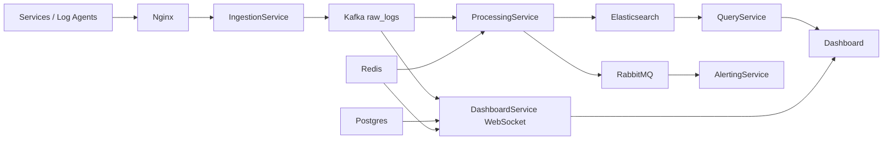

# Watcher - Real-time Log Analytics Dashboard

Watcher is a Spring Boot + Gradle PoC for real-time log ingestion, processing, search, dashboard metadata, live tail, and alerting.

## Architecture



## Services

| Service | Port | Responsibility |
| --- | --- | --- |
| IngestionService | 8080 | Receive JSON log payloads and publish raw events to Kafka. |
| ProcessingService | 8081 | Consume raw logs, parse/filter/enrich, index to Elasticsearch, trigger alert tasks. |
| QueryService | 8082 | Search and summarize indexed logs from Elasticsearch. |
| DashboardService | 8083 | Store dashboard config in Postgres, cache with Redis, push Live Tail via WebSocket. |
| AlertingService | 8084 | Consume RabbitMQ alert tasks and send console/Slack/email-style notifications. |
| Nginx | 8088 | Reverse proxy for ingestion, query, dashboard, and WebSocket routes. |

Postgres stores metadata/config only. Elasticsearch stores searchable log data.

## Requirements

- Java 8+ for this PoC build.
- Docker + Docker Compose for the full runtime.
- Gradle wrapper is included and uses Gradle 7.6.4.

## Build

```powershell
.\gradlew.bat clean build
```

## Run with Docker Compose

```powershell
docker compose up --build
```

Useful URLs:

- Nginx entrypoint: http://localhost:8088
- Kibana: http://localhost:5601
- Elasticsearch: http://localhost:9200
- RabbitMQ management: http://localhost:15672
- QueryService: http://localhost:8082
- DashboardService: http://localhost:8083

RabbitMQ default login is `guest` / `guest`.

## Send a log

```powershell
$body = @{
  level = "ERROR"
  message = "Payment failed"
  serviceName = "payment-service"
  traceId = "trace-001"
  timestamp = "2026-05-22T07:30:00Z"
} | ConvertTo-Json

Invoke-RestMethod `
  -Method Post `
  -Uri "http://localhost:8088/log" `
  -Headers @{ "X-API-Key" = "dev-api-key" } `
  -ContentType "application/json" `
  -Body $body
```

## Query logs

```powershell
Invoke-RestMethod "http://localhost:8088/api/v1/logs?level=ERROR&serviceName=payment-service"
Invoke-RestMethod "http://localhost:8088/api/v1/metrics/summary"
```

## Dashboard config

```powershell
$dashboard = @{
  owner = "demo"
  name = "Payment Errors"
  configJson = '{"widgets":[{"type":"timeseries","query":"level:ERROR serviceName:payment-service"}]}'
} | ConvertTo-Json

Invoke-RestMethod `
  -Method Post `
  -Uri "http://localhost:8088/api/v1/dashboards" `
  -ContentType "application/json" `
  -Body $dashboard
```

## Live Tail

Open [tools/live-tail-demo.html](tools/live-tail-demo.html) in a browser after `docker compose up --build`, then send a log. The page subscribes to `/topic/logs` through DashboardService WebSocket.

## Notes

- Compose sets `WATCHER_ALERT_ERROR_THRESHOLD=1` so any ERROR log triggers a demo alert.
- In production, use a higher threshold and add cooldown/deduplication.
- The current PoC keeps API contracts intentionally small. OpenAPI can be added when endpoint design is stable.
