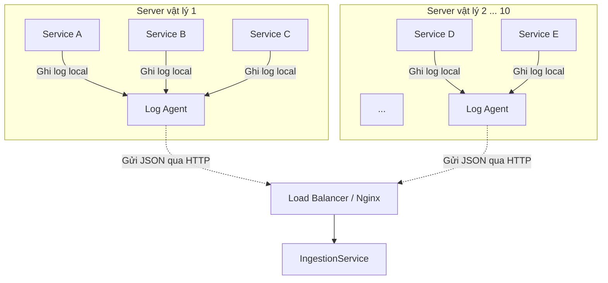

# System Requirements - Real-time Log Analytics Dashboard

## 1. Mục tiêu

Hệ thống Real-time Log Analytics Dashboard cho phép các microservices bên ngoài gửi log/metric tập trung, xử lý dữ liệu theo luồng, lưu trữ để tìm kiếm/phân tích và cung cấp dashboard gần real-time cho developer, SRE và đội vận hành.

Trong phạm vi Lean MVP / Demo PoC, mục tiêu chính là chứng minh đường ống dữ liệu end-to-end:

Client service -> Log Agent -> Nginx -> Ingestion -> Kafka -> Processing -> Elasticsearch -> QueryService / Custom Dashboard / Kibana

Các tính năng real-time như Alerting và Live Tail được triển khai sau khi core pipeline hoạt động ổn định.

## 2. Đối tượng sử dụng

| Actor | Mục đích sử dụng |
| --- | --- |
| Developer | Tìm kiếm log theo service, level, trace id, message để debug lỗi. |
| SRE / Ops | Theo dõi tình trạng hệ thống, phát hiện spike lỗi, xem live log khi incident xảy ra. |
| Admin vận hành | Quản lý cấu hình môi trường, pipeline, logging, dashboard và tích hợp cảnh báo. |
| Client microservice | Sinh log nghiệp vụ/vận hành và ghi ra cơ chế local để Log Agent thu thập. |
| Log Agent | Chạy trên server vật lý/VM, gom log từ các service cùng máy và gửi JSON qua HTTP đến ingestion layer. |

## 3. Client gửi log và Log Agent

Nguồn log của hệ thống là các microservices hoặc ứng dụng backend cần gửi log tập trung. Ví dụ:

- `UserService`, `ProductService`, `BookingService` hoặc các service nghiệp vụ tương tự.
- Service ghi log local trên server vật lý/VM nơi nó chạy.
- Log Agent cục bộ gom log từ nhiều service cùng máy, chuẩn hóa hoặc đóng gói thành JSON rồi gửi qua HTTP đến Nginx.
- Nginx chuyển tiếp request đến IngestionService phía sau.
- Service nghiệp vụ và Log Agent không ghi trực tiếp vào Elasticsearch hoặc RabbitMQ; mọi log đi qua ingestion layer.

## 4. Phạm vi Demo/PoC

### In scope

- Nhận log/metric từ client service thông qua IngestionService.
- Thu thập log từ các service trên server vật lý/VM thông qua Log Agent cục bộ.
- Đẩy raw log vào Kafka để buffering.
- Consume raw log bằng ProcessingService.
- Parse, filter và enrich cơ bản.
- Lưu dữ liệu đã xử lý vào Elasticsearch.
- Kiểm chứng dữ liệu bằng Kibana.
- Lưu metadata/config như dashboard config, alert rule, API key bằng Postgres ở mức PoC.
- Cung cấp hướng requirement cho QueryService, DashboardService, AlertingService và Live Tail.
- Mô tả yêu cầu vận hành cơ bản: Docker Compose, ELK logging, GitLab CI/CD concept.

### Out of scope tạm thời

- Test plan chi tiết.
- Danh sách endpoint REST cụ thể.
- Schema chi tiết cho từng Kafka/RabbitMQ message.
- File OpenAPI đầy đủ.
- Code mẫu Spring Boot chi tiết.
- Multi-tenant đầy đủ.
- RBAC nâng cao.
- Kubernetes production HA.
- Retention policy phức tạp.
- Disaster recovery chi tiết.

## 5. Nguyên tắc thiết kế requirement

- Core Pipeline là ưu tiên số một; dữ liệu phải chảy end-to-end trước khi mở rộng tính năng.
- IngestionService phải nhẹ, ít xử lý, phản hồi nhanh và không ghi trực tiếp vào storage cuối.
- Kafka là backbone cho log streaming, không bị thay thế bởi RabbitMQ.
- RabbitMQ chỉ phục vụ alert task bất đồng bộ.
- Redis chỉ phục vụ cache/counter ngắn hạn, không phải storage chính.
- Elasticsearch là storage/search/indexing layer cho dữ liệu đã xử lý.
- Postgres là database cho metadata/config của ứng dụng, không phải nơi lưu log chính.
- WebSocket được dùng cho Live Tail vì cần push real-time.
- Các service backend được định hướng triển khai bằng Spring Boot và build bằng Gradle.
- Tài liệu này mô tả requirement, không phải hướng dẫn implementation chi tiết.

## 6. Functional Requirements

| ID | Capability | Requirement |
| --- | --- | --- |
| FR-01 | Log Collection | Hệ thống phải hỗ trợ Log Agent cục bộ trên server vật lý/VM để gom log từ nhiều service cùng máy. |
| FR-02 | Log Collection | Log Agent phải gửi log dạng JSON hoặc payload có cấu trúc qua HTTP đến Nginx/ingestion layer. |
| FR-03 | Ingestion | Hệ thống phải nhận log/metric từ Log Agent hoặc client được phê duyệt thông qua một ingestion interface tập trung. |
| FR-04 | Ingestion | IngestionService phải xác thực request ở mức cơ bản, ví dụ API key hoặc token nội bộ. |
| FR-05 | Ingestion | IngestionService phải publish raw payload vào Kafka và trả phản hồi nhanh cho client. |
| FR-06 | Ingestion | IngestionService không được parse sâu, enrich, filter nghiệp vụ hoặc ghi trực tiếp vào Elasticsearch. |
| FR-07 | Buffering | Kafka phải đóng vai trò buffer giữa tốc độ gửi log và tốc độ xử lý log. |
| FR-08 | Processing | ProcessingService phải consume raw log từ Kafka, parse payload và chuẩn hóa dữ liệu. |
| FR-09 | Processing | ProcessingService phải hỗ trợ filter log không cần thiết theo cấu hình, ví dụ bỏ DEBUG log ở môi trường production. |
| FR-10 | Processing | ProcessingService phải hỗ trợ enrich dữ liệu cơ bản, ví dụ bổ sung metadata service hoặc thông tin vị trí từ IP nếu có nguồn dữ liệu. |
| FR-11 | Storage | Dữ liệu đã xử lý phải được index vào Elasticsearch để tìm kiếm và phân tích. |
| FR-12 | Metadata | Postgres phải được dùng cho metadata/config như dashboard config, alert rule, API key hoặc thông tin project/team. |
| FR-13 | Metadata | Postgres không được dùng làm log storage chính hoặc thay thế Elasticsearch cho search/analytics log. |
| FR-14 | Query | QueryService phải cung cấp năng lực truy vấn log đã xử lý theo thời gian, level, service và nội dung message. |
| FR-15 | Dashboard | Custom Dashboard phải hỗ trợ visualization và quản lý cấu hình dashboard của người dùng ở mức PoC. |
| FR-16 | Visualization | Kibana dùng để kiểm chứng và quan sát dữ liệu trong Elasticsearch, không thay thế Custom Dashboard của sản phẩm. |
| FR-17 | Live Tail | Hệ thống phải hỗ trợ xem log gần real-time qua WebSocket sau khi core pipeline hoạt động. |
| FR-18 | Alerting | Hệ thống phải hỗ trợ tạo alert task bất đồng bộ khi phát hiện điều kiện bất thường. |
| FR-19 | Observability | Các microservices phải xuất log vận hành để có thể gom về ELK. |
| FR-20 | Delivery | Dự án phải có định hướng GitLab CI/CD để validate, build, package image và deploy PoC. |

## 7. Non-functional Requirements

| ID | Nhóm | Requirement |
| --- | --- | --- |
| NFR-01 | Throughput | Kiến trúc phải cho phép mở rộng theo chiều ngang để hướng tới tải rất lớn, bao gồm hàng triệu event/phút ở production target. |
| NFR-02 | Throughput | PoC không cần chứng minh hàng triệu event/phút trên một máy, nhưng phải giữ đúng cơ chế partitioning, batching và async processing để scale về sau. |
| NFR-03 | Latency | IngestionService phải phản hồi nhanh sau khi publish vào Kafka, không chờ xử lý downstream. |
| NFR-04 | Scalability | IngestionService và ProcessingService phải có thể chạy nhiều instance. |
| NFR-05 | Reliability | Kafka phải là lớp hấp thụ spike traffic và giảm mất dữ liệu khi downstream chậm. |
| NFR-06 | Reliability | Alerting không được làm chậm core log processing pipeline. |
| NFR-07 | Observability | Mỗi service phải có log có cấu trúc, correlation/trace id nếu có và thông tin lỗi đủ để debug. |
| NFR-08 | Security | Ingestion interface không được nhận log từ client không xác thực. |
| NFR-09 | Maintainability | Service boundaries phải rõ ràng; mỗi service có trách nhiệm hẹp và dễ thay thế. |
| NFR-10 | Operability | Môi trường PoC phải có thể chạy bằng Docker Compose. |
| NFR-11 | Maintainability | Backend service phải theo chuẩn Spring Boot và build bằng Gradle để thống nhất toolchain. |

## 8. Acceptance Criteria tổng quan

- Có thể gửi một log JSON từ Log Agent hoặc client giả lập qua Nginx/ingestion layer.
- Log được publish vào Kafka mà IngestionService không xử lý sâu.
- ProcessingService consume được log, parse thành dữ liệu có cấu trúc và lưu vào Elasticsearch.
- Kibana có thể hiển thị hoặc tìm kiếm log đã được index trong Elasticsearch.
- Custom Dashboard và Kibana được mô tả tách biệt về trách nhiệm.
- Postgres được xác định rõ là metadata/config database, không phải log storage.
- Thiết kế requirement thể hiện rõ các giai đoạn tiếp theo: Alerting, Live Tail và production readiness.
- GitLab CI/CD được xác định là hướng triển khai pipeline mặc định.

## 9. Giả định

- Tài liệu này phục vụ giai đoạn phân tích yêu cầu, chưa khóa thiết kế API chi tiết.
- Scope hiện tại là Demo/PoC, nhưng không phá vỡ hướng mở rộng production.
- Alert email/Slack ở PoC có thể dùng mock sender hoặc webhook cấu hình được.
- Frontend dashboard chưa cần thiết kế UI chi tiết trong phase requirement này.
