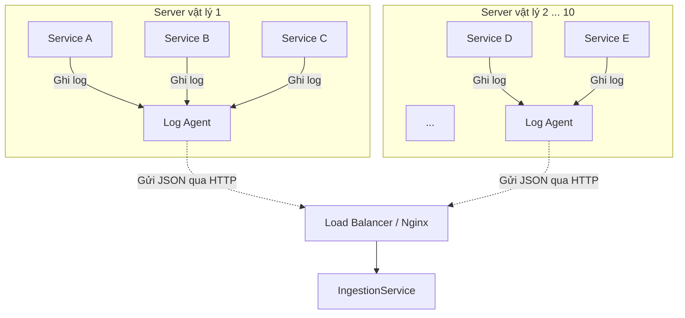
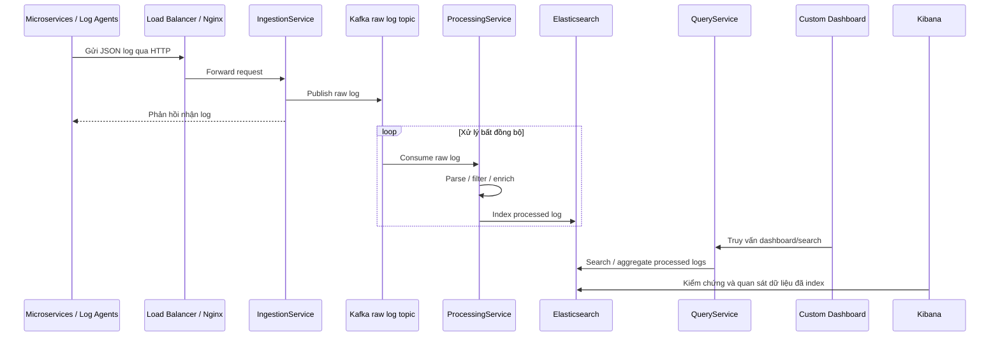

# Core Pipeline Requirements

## 1. Mục tiêu giai đoạn 1

Giai đoạn 1 tập trung xây dựng đường ống dữ liệu cốt lõi, đảm bảo log có thể chảy từ service sinh log đến Elasticsearch:

Client service -> Log Agent -> Nginx -> IngestionService -> Kafka -> ProcessingService -> Elasticsearch -> Kibana

Đây là phần quan trọng nhất của PoC. Các tính năng Alerting, Live Tail và production readiness chỉ nên bổ sung sau khi pipeline này chạy end-to-end.

## 2. Infrastructure PoC

Môi trường PoC dùng Docker Compose để dựng nhanh các thành phần nền tảng.

| Thành phần | Vai trò |
| --- | --- |
| Zookeeper | Điều phối Kafka trong cấu hình PoC dùng Confluent image truyền thống. |
| Kafka | Buffer chính cho raw log stream. |
| Elasticsearch | Lưu trữ và index dữ liệu log đã xử lý. |
| Kibana | Công cụ kiểm chứng, tìm kiếm và quan sát dữ liệu trong Elasticsearch. |
| Postgres | Database metadata/config cho dashboard, alert rule, API key hoặc thông tin project/team khi các service cần lưu cấu hình. |

Yêu cầu:

- Docker Compose phải đủ để khởi động hạ tầng PoC cục bộ.
- Cấu hình ưu tiên đơn giản, dùng port mặc định khi phù hợp.
- Image nên lấy từ Confluent cho Kafka/Zookeeper và Elastic cho Elasticsearch/Kibana.
- Infrastructure PoC chưa cần HA, cluster nhiều node hoặc tuning production.
- Postgres không thuộc luồng lưu log chính; dữ liệu log vẫn được index vào Elasticsearch.

## 3. Physical View

Physical View mô tả cách log được gom tại từng server vật lý/VM trước khi đi vào ingestion layer. Log Agent là thành phần cục bộ trên server, giúp các service nghiệp vụ không phải tự tích hợp trực tiếp với Kafka hoặc Elasticsearch.

## 4. Logical Pipeline Diagram

## 5. Log Agent Requirements

Log Agent là thành phần thu thập log tại server vật lý/VM.

| ID | Requirement |
| --- | --- |
| AGT-01 | Mỗi server vật lý/VM chạy nhiều service có thể có một Log Agent cục bộ để gom log. |
| AGT-02 | Log Agent phải gửi log dạng JSON hoặc payload có cấu trúc qua HTTP đến Nginx/ingestion layer. |
| AGT-03 | Log Agent không được ghi trực tiếp vào Kafka, Elasticsearch hoặc RabbitMQ trong scope PoC. |
| AGT-04 | Log Agent phải có khả năng thêm metadata tối thiểu như source host, service name hoặc environment nếu dữ liệu này có sẵn. |
| AGT-05 | Log Agent phải xử lý lỗi gửi tạm thời theo hướng retry/buffer cục bộ ở mức phù hợp với phase implementation sau. |

## 6. IngestionService Requirements

IngestionService là cửa ngõ nhận log từ Log Agent hoặc client nội bộ được phê duyệt.

| ID | Requirement |
| --- | --- |
| ING-01 | Service phải nhận log/metric từ Log Agent hoặc client nội bộ qua HTTP ingestion interface. |
| ING-02 | Service phải hỗ trợ payload dạng JSON hoặc raw string chứa JSON. |
| ING-03 | Service phải xác thực request ở mức cơ bản, ví dụ API key. |
| ING-04 | Service phải publish raw payload vào Kafka topic dành cho log thô. |
| ING-05 | Service phải phản hồi nhanh sau khi Kafka nhận message để tránh giữ kết nối client quá lâu. |
| ING-06 | Service không được parse sâu, filter, enrich hoặc ghi Elasticsearch. |
| ING-07 | Khi Kafka không sẵn sàng, service phải trả lỗi rõ ràng để client có thể retry theo chính sách riêng. |
| ING-08 | Log vận hành của service phải đủ thông tin để debug lỗi ingest nhưng không làm lộ secret/API key. |

Ghi chú thiết kế:

- Tên endpoint cụ thể chưa khóa trong tài liệu requirement này.
- IngestionService có thể scale ngang phía sau Nginx hoặc API Gateway ở các phase sau.
- Cơ chế xác thực PoC có thể đơn giản, nhưng phải có điểm mở rộng cho authentication nghiêm ngặt hơn.
- IngestionService được định hướng triển khai bằng Spring Boot và build bằng Gradle.

## 7. Kafka Buffering Requirements

Kafka là backbone của core pipeline, giúp tách tốc độ ghi log khỏi tốc độ xử lý downstream.

| ID | Requirement |
| --- | --- |
| KAF-01 | Hệ thống phải có topic raw log để nhận toàn bộ payload từ IngestionService. |
| KAF-02 | Topic raw log phải có khả năng partition để scale consumer processing. |
| KAF-03 | IngestionService đóng vai trò Kafka producer. |
| KAF-04 | ProcessingService đóng vai trò Kafka consumer. |
| KAF-05 | Kafka phải giữ dữ liệu đủ lâu trong PoC để xử lý lại khi ProcessingService restart ngắn hạn. |
| KAF-06 | Thiết kế phải cho phép bổ sung topic dữ liệu sạch ở phase sau nếu cần tách clean stream khỏi Elasticsearch writer. |

Yêu cầu tránh nhầm lẫn:

- Kafka dùng cho streaming log liên tục.
- RabbitMQ không thay Kafka trong core log pipeline.
- Elasticsearch không nhận dữ liệu trực tiếp từ IngestionService.

## 8. ProcessingService Requirements

ProcessingService biến raw log thành dữ liệu có cấu trúc và có thể tìm kiếm.

| ID | Requirement |
| --- | --- |
| PRC-01 | Service phải consume raw log từ Kafka. |
| PRC-02 | Service phải parse payload JSON để lấy các trường quan trọng như timestamp, level, message, service name, trace id nếu có. |
| PRC-03 | Service phải xử lý payload không parse được mà không làm dừng consumer. |
| PRC-04 | Service phải chuẩn hóa dữ liệu đầu ra trước khi lưu. |
| PRC-05 | Service phải hỗ trợ filter cơ bản theo cấu hình, ví dụ bỏ log DEBUG khi không cần. |
| PRC-06 | Service phải hỗ trợ enrich cơ bản khi nguồn dữ liệu có sẵn, ví dụ metadata service hoặc geo information từ IP. |
| PRC-07 | Service phải ghi dữ liệu đã xử lý vào Elasticsearch. |
| PRC-08 | Service phải log lỗi xử lý đủ rõ để debug message lỗi và nguyên nhân lỗi. |
| PRC-09 | Service được định hướng triển khai bằng Spring Boot, dùng Gradle làm build tool thống nhất với các backend service khác. |

## 9. Elasticsearch, Kibana và Postgres Requirements

Elasticsearch là nơi lưu trữ và lập chỉ mục dữ liệu log đã xử lý.

| ID | Requirement |
| --- | --- |
| ES-01 | Dữ liệu đã xử lý phải được index vào Elasticsearch. |
| ES-02 | Index phải hỗ trợ truy vấn theo thời gian, level, service name và message. |
| ES-03 | Dữ liệu phải có timestamp chuẩn để hỗ trợ range query và visualization. |
| ES-04 | Kibana phải dùng được để kiểm chứng log đã vào Elasticsearch trong PoC. |
| ES-05 | Mapping/index template production chưa cần khóa ở phase requirement này, nhưng thiết kế không được cản trở việc bổ sung sau. |
| ES-06 | Kibana chỉ là công cụ kiểm chứng/quan sát trên Elasticsearch, không thay thế Custom Dashboard của sản phẩm. |
| PG-01 | Postgres phải được dùng cho metadata/config ứng dụng khi cần lưu dashboard config, alert rule, API key hoặc thông tin project/team. |
| PG-02 | Postgres không được dùng để lưu raw log hoặc processed log làm nguồn search/analytics chính. |

## 10. Điều kiện hoàn thành giai đoạn 1

- Docker Compose khởi động được Kafka, Zookeeper, Elasticsearch và Kibana.
- IngestionService nhận được log từ Log Agent hoặc client giả lập qua Nginx/ingestion layer.
- Log raw được publish vào Kafka.
- ProcessingService consume được raw log từ Kafka.
- Log hợp lệ được parse và lưu vào Elasticsearch.
- Kibana có thể tìm thấy log vừa ingest.
- Log lỗi parse không làm dừng pipeline.
- Vai trò Custom Dashboard, Kibana và Postgres được phân tách rõ trong tài liệu requirement.
