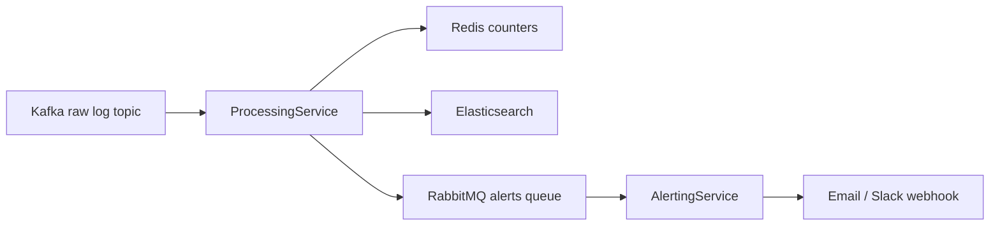
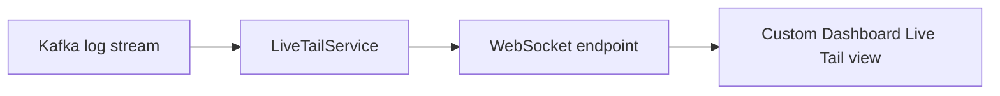
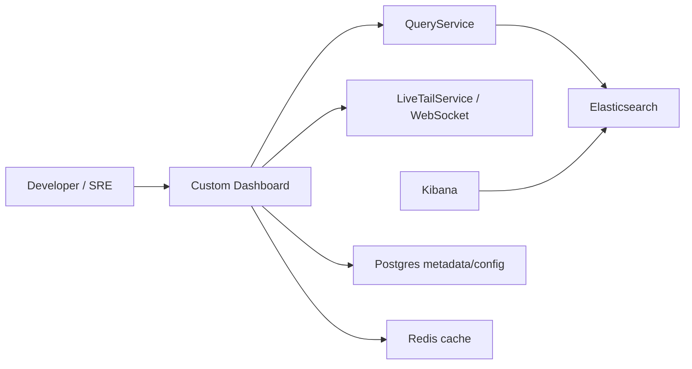

# Real-time Features Requirements

## 1. Mục tiêu giai đoạn 2

Giai đoạn 2 bổ sung các tính năng real-time sau khi Core Pipeline đã chạy ổn định:

- Alerting: phát hiện bất thường và gửi nhiệm vụ cảnh báo bất đồng bộ.
- Live Tail: xem log gần real-time trên Custom Dashboard.
- Redis optimization: cache cấu hình dashboard và đếm sự kiện trong cửa sổ thời gian ngắn.
- Postgres metadata: lưu cấu hình bền vững như dashboard config và alert rule.

Các tính năng này không thay thế core pipeline. Chúng mở rộng pipeline hiện có mà không làm chậm luồng ingest/process chính.

## 2. Alerting Requirements

Alerting dùng RabbitMQ như task queue để xử lý cảnh báo ngoài luồng.

| ID | Requirement |
| --- | --- |
| ALT-01 | ProcessingService phải có khả năng phát hiện điều kiện bất thường ở mức cơ bản, ví dụ số lượng ERROR vượt ngưỡng trong một khoảng thời gian ngắn. |
| ALT-02 | Khi phát hiện bất thường, ProcessingService phải tạo alert task và gửi vào RabbitMQ. |
| ALT-03 | ProcessingService không được tự gửi email/Slack trong luồng xử lý log chính. |
| ALT-04 | AlertingService phải consume alert task từ RabbitMQ. |
| ALT-05 | AlertingService phải hỗ trợ gửi cảnh báo qua email hoặc Slack webhook ở mức PoC. |
| ALT-06 | Nếu gửi cảnh báo thất bại, lỗi phải được log rõ và không làm crash toàn bộ service. |
| ALT-07 | RabbitMQ chỉ dùng cho task cảnh báo, không thay thế Kafka cho log streaming. |

Ghi chú:

- Điều kiện alert chi tiết chưa khóa ở phase requirement này.
- PoC có thể mô phỏng gửi email/Slack bằng console log hoặc mock sender nếu chưa có credential thật.
- Alerting phải có cơ chế tránh spam cảnh báo ở phase thiết kế sau, ví dụ cooldown hoặc deduplication.

## 3. Live Tail Requirements

Live Tail cho phép người dùng xem log đang chảy về hệ thống gần real-time, tương tự trải nghiệm `tail -f`.

| ID | Requirement |
| --- | --- |
| LVT-01 | Hệ thống phải hỗ trợ kết nối WebSocket để push log về frontend. |
| LVT-02 | LiveTailService phải subscribe log stream từ Kafka hoặc stream đã xử lý tùy thiết kế phase implementation. |
| LVT-03 | Khi có log mới, service phải broadcast đến các client đang xem Live Tail phù hợp. |
| LVT-04 | WebSocket là cơ chế chính cho Live Tail, không dùng HTTP polling làm cơ chế chính. |
| LVT-05 | Service phải xử lý client disconnect mà không ảnh hưởng đến Kafka consumer. |
| LVT-06 | Dữ liệu gửi qua WebSocket phải có đủ thông tin cơ bản để hiển thị: thời gian, level, service và message nếu có. |
| LVT-07 | LiveTailService được định hướng triển khai bằng Spring Boot và build bằng Gradle như các backend service khác. |

Ghi chú:

- Trong PoC, có thể broadcast tất cả log cho mọi client.
- Ở phase sau, cần bổ sung filter theo service, level, environment hoặc tenant nếu hệ thống mở rộng.

## 4. Custom Dashboard, Kibana và Query Flow

Custom Dashboard là sản phẩm người dùng tương tác để xem dashboard cá nhân, truy vấn log và Live Tail. Kibana là công cụ quan sát/kiểm chứng trên Elasticsearch, không phải thay thế cho Custom Dashboard.

## 5. DashboardService Requirements

DashboardService quản lý trải nghiệm truy vấn và visualization ở mức requirement.

| ID | Requirement |
| --- | --- |
| DSB-01 | Service phải hỗ trợ lưu cấu hình dashboard của người dùng ở mức PoC. |
| DSB-02 | Dashboard config có thể bao gồm danh sách widget, query/filter cơ bản và khoảng thời gian mặc định. |
| DSB-03 | Service phải đọc dữ liệu log/metric thông qua QueryService hoặc Elasticsearch access layer được phê duyệt trong phase thiết kế. |
| DSB-04 | Service phải tích hợp với Live Tail view để hiển thị log gần real-time. |
| DSB-05 | Dashboard config phải được lưu bền vững trong Postgres khi scope implementation cần persistence. |
| DSB-06 | Dashboard config thường dùng phải có thể cache bằng Redis. |
| DSB-07 | DashboardService được định hướng triển khai bằng Spring Boot và build bằng Gradle. |

## 6. QueryService Requirements

QueryService cung cấp năng lực truy vấn dữ liệu đã xử lý.

| ID | Requirement |
| --- | --- |
| QRY-01 | Service phải truy vấn dữ liệu từ Elasticsearch, không truy vấn trực tiếp Kafka. |
| QRY-02 | Service phải hỗ trợ tìm kiếm log theo khoảng thời gian. |
| QRY-03 | Service phải hỗ trợ filter cơ bản theo service name, level và message. |
| QRY-04 | Service phải hỗ trợ aggregation cơ bản phục vụ biểu đồ, ví dụ số lượng log theo phút hoặc theo level. |
| QRY-05 | Service phải giới hạn kết quả trả về để tránh query quá nặng trong PoC. |
| QRY-06 | QueryService được định hướng triển khai bằng Spring Boot và build bằng Gradle. |

## 7. Redis và Postgres Requirements

Redis phục vụ tối ưu ngắn hạn, không phải storage chính. Postgres phục vụ dữ liệu metadata/config cần lưu bền vững, không phải nơi lưu log chính.

| ID | Requirement |
| --- | --- |
| RDS-01 | Redis phải dùng được để cache dashboard config hoặc query metadata thường dùng. |
| RDS-02 | Redis phải dùng được để đếm sự kiện trong cửa sổ thời gian ngắn, ví dụ số ERROR trong 1 phút. |
| RDS-03 | Counter trong Redis phải có TTL để tránh tăng dữ liệu không kiểm soát. |
| RDS-04 | Mất Redis tạm thời không được làm dừng core pipeline; hệ thống phải degrade hợp lý ở các tính năng cache/counting. |
| PG-01 | Postgres phải dùng cho dashboard config, alert rule, API key hoặc metadata project/team khi cần persistence. |
| PG-02 | Postgres không được dùng làm backend chính cho search log hoặc analytics log. |

## 8. Điều kiện hoàn thành giai đoạn 2

- Alert task có thể được tạo khi phát hiện log bất thường.
- AlertingService nhận được task từ RabbitMQ và mô phỏng gửi cảnh báo.
- Custom Dashboard demo có thể nhận log mới qua WebSocket.
- Dashboard config cơ bản có thể được lưu trong Postgres và cache bằng Redis ở mức PoC.
- Kibana vẫn được dùng cho quan sát Elasticsearch, không bị gộp vai trò với Custom Dashboard.
- Core Pipeline vẫn hoạt động khi Alerting hoặc Live Tail gặp lỗi cục bộ.
