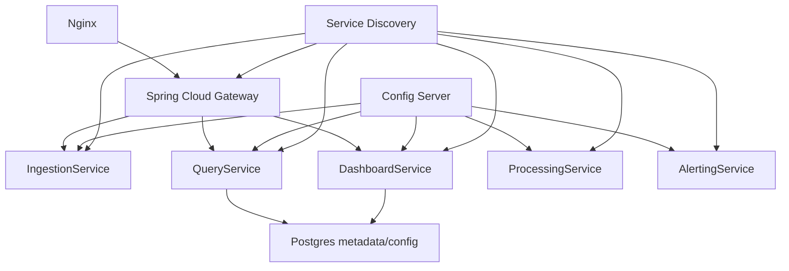
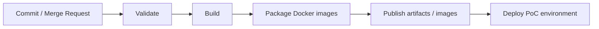

# Production Readiness Requirements

## 1. Mục tiêu giai đoạn 3

Giai đoạn 3 định hướng production hóa hệ thống sau khi Core Pipeline và các tính năng real-time đã có PoC. Tài liệu này chưa yêu cầu triển khai full production, nhưng xác định các capability cần bổ sung để hệ thống microservices có thể vận hành nghiêm túc hơn.

Các backend service của hệ thống được định hướng triển khai bằng Spring Boot và build bằng Gradle. Postgres được dùng cho dữ liệu metadata/config của ứng dụng; Elasticsearch vẫn là storage/search layer cho log đã xử lý.

## 2. Implementation Standard Requirements

| ID | Requirement |
| --- | --- |
| STD-01 | Các backend service phải theo chuẩn Spring Boot để thống nhất framework, cấu hình và vận hành. |
| STD-02 | Gradle là build tool mặc định cho các service Java/Spring. |
| STD-03 | Cấu trúc repository ở phase implementation phải hỗ trợ build từng service độc lập hoặc theo multi-module nếu đội phát triển chọn cách tổ chức đó. |
| STD-04 | Postgres phải được dùng cho metadata/config cần lưu bền vững như dashboard config, alert rule, API key, user/project/team metadata. |
| STD-05 | Postgres không được dùng làm nơi lưu raw log, processed log hoặc thay thế Elasticsearch cho search/analytics log. |

## 3. Spring Cloud Requirements

| ID | Requirement |
| --- | --- |
| SC-01 | Hệ thống phải có định hướng dùng Spring Cloud Config Server để quản lý cấu hình tập trung. |
| SC-02 | Cấu hình Kafka, Elasticsearch, RabbitMQ, Redis và service endpoint không nên hard-code trong source code. |
| SC-03 | Hệ thống phải có định hướng dùng Service Discovery bằng Eureka hoặc Consul. |
| SC-04 | Các service chính phải có thể đăng ký vào Service Discovery ở phase production hóa. |
| SC-05 | Spring Cloud Gateway phải là API Gateway chính cho các API public/internal cần expose. |
| SC-06 | Gateway phải route request đến service nội bộ dựa trên service name thay vì địa chỉ hard-code ở phase production hóa. |

## 4. Nginx Requirements

Nginx đứng trước API Gateway hoặc IngestionService tùy phase triển khai.

| ID | Requirement |
| --- | --- |
| NGX-01 | Nginx phải đóng vai trò reverse proxy phía ngoài. |
| NGX-02 | Nginx phải hỗ trợ load balancing cho IngestionService hoặc API Gateway. |
| NGX-03 | Nginx phải là điểm phù hợp để cấu hình SSL/TLS ở môi trường cao hơn PoC. |
| NGX-04 | Nginx phải hỗ trợ giới hạn request cơ bản để bảo vệ ingestion interface khi cần. |
| NGX-05 | Nginx phải nhận traffic JSON log từ Log Agent trên các server vật lý/VM và phân phối đến ingestion layer phía sau. |

Ghi chú:

- Trong PoC rất sớm, Nginx có thể đứng trực tiếp trước IngestionService.
- Khi có API Gateway, Nginx nên đứng trước Gateway và để Gateway route vào service nội bộ.

## 5. Observability, Log Agent và ELK Requirements

ELK logging tập trung giúp quan sát chính hệ thống log analytics.

| ID | Requirement |
| --- | --- |
| OBS-01 | Tất cả microservices phải ghi log có cấu trúc. |
| OBS-02 | Log vận hành phải có service name, timestamp, level và correlation/trace id nếu có. |
| OBS-03 | Log của các microservices phải được gom về ELK hoặc pipeline logging tương đương. |
| OBS-04 | Kibana phải có thể dùng để kiểm tra lỗi vận hành của chính các service trong hệ thống. |
| OBS-05 | Các lỗi quan trọng như Kafka publish fail, parse fail, Elasticsearch write fail và alert send fail phải được log rõ. |
| OBS-06 | Các server vật lý/VM có thể dùng Log Agent cục bộ để gom log từ nhiều service trước khi gửi về ingestion layer. |
| OBS-07 | Kibana là công cụ observability trên Elasticsearch, trong khi Custom Dashboard là sản phẩm dashboard riêng cho người dùng hệ thống. |

## 6. GitLab CI/CD Requirements

GitLab CI/CD là hướng mặc định cho delivery pipeline.

| ID | Requirement |
| --- | --- |
| CICD-01 | Dự án phải có GitLab CI pipeline ở phase implementation. |
| CICD-02 | Pipeline phải có bước validate source/config ở mức tối thiểu. |
| CICD-03 | Pipeline phải build được từng service bằng Gradle. |
| CICD-04 | Pipeline phải package Docker image cho các service cần deploy. |
| CICD-05 | Pipeline phải publish artifact hoặc image vào registry được cấu hình. |
| CICD-06 | Pipeline phải có hướng deploy môi trường PoC, ví dụ Docker Compose hoặc runner script nội bộ. |
| CICD-07 | Secret như API key, registry credential, webhook URL không được hard-code trong repository. |

Ghi chú:

- Tài liệu này không định nghĩa test plan chi tiết.
- Khi bước test được đưa vào scope, GitLab CI nên chạy unit/integration test trước khi build image production candidate.

## 7. Swagger/OpenAPI Requirements

| ID | Requirement |
| --- | --- |
| API-01 | Các service expose HTTP API phải có tài liệu Swagger/OpenAPI ở phase thiết kế/implementation. |
| API-02 | OpenAPI phải mô tả request/response, error format và authentication scheme ở mức phù hợp. |
| API-03 | Endpoint cụ thể chưa khóa trong requirement hiện tại để tránh thiết kế quá sớm. |
| API-04 | API documentation phải được cập nhật cùng version service khi interface thay đổi. |

## 8. Docker Compose Requirements

Docker Compose là môi trường demo mặc định cho PoC.

| ID | Requirement |
| --- | --- |
| DOC-01 | Compose file phải khởi động được các dependency nền tảng cần cho PoC. |
| DOC-02 | Compose file giai đoạn 1 tối thiểu gồm Kafka, Zookeeper, Elasticsearch và Kibana. |
| DOC-03 | Compose file giai đoạn 2 có thể bổ sung RabbitMQ, Redis và Postgres cho metadata/config. |
| DOC-04 | Compose file không cần mô phỏng đầy đủ production HA. |
| DOC-05 | Cấu hình local phải dễ reset và không phụ thuộc secret thật. |

## 9. Điều kiện hoàn thành giai đoạn 3

- Có chuẩn implementation bằng Spring Boot và Gradle cho backend services.
- Có định hướng cấu hình tập trung bằng Spring Cloud Config Server.
- Có lựa chọn Service Discovery: Eureka hoặc Consul.
- Có API Gateway làm cửa ngõ route service.
- Có Nginx đứng trước gateway hoặc ingestion layer.
- Có chiến lược logging tập trung cho toàn bộ microservices.
- Có Log Agent trong Physical View để gom log từ server vật lý/VM.
- Có Postgres cho metadata/config, tách biệt rõ với Elasticsearch log storage.
- Có GitLab CI/CD concept rõ ràng cho validate, build, package và deploy PoC.
- Có requirement cho Swagger/OpenAPI nhưng chưa khóa endpoint cụ thể.
